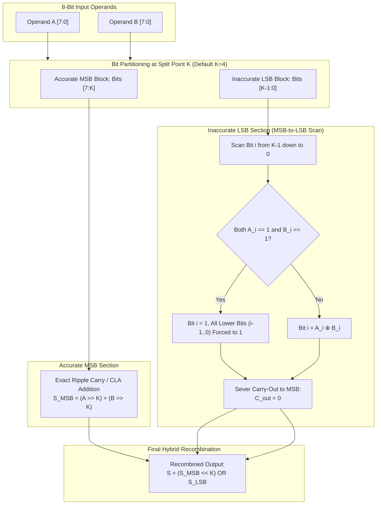
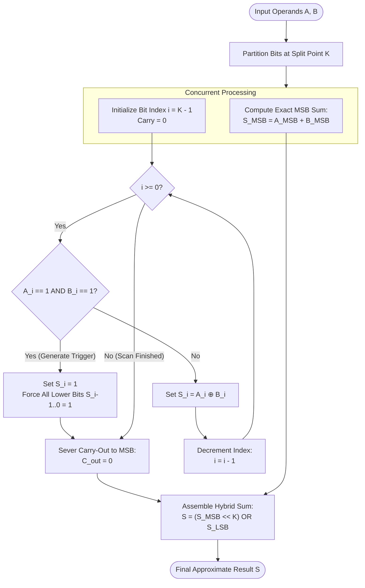

# MSB-Triggered ETA-1 Approximate Arithmetic Adder for Image Processing and Edge AI

<p align="center">
  
  
  
  
  
</p>

An end-to-end research, simulation, and hardware benchmarking framework for the **MSB-Triggered ETA-1 (Error-Tolerant Adder Type I)** hybrid approximate arithmetic architecture. Demonstrates dramatic dynamic power, critical path latency, and silicon area savings across error-resilient workloads including Edge AI facial verification and computer vision spatial filtering.

---

## Table of Contents
- [1. Project Title & Overview](#1-project-title--overview)
- [2. Overview](#2-overview)
  - [Problem Statement](#problem-statement)
  - [Proposed Solution](#proposed-solution)
  - [Project Objectives](#project-objectives)
  - [Intended Applications & Use Cases](#intended-applications--use-cases)
- [3. Key Features](#3-key-features)
- [4. System Architecture](#4-system-architecture)
- [5. Technology Stack](#5-technology-stack)
- [6. Repository Structure](#6-repository-structure)
- [7. Hardware Requirements (VLSI Synthesis Target)](#7-hardware-requirements-vlsi-synthesis-target)
- [8. Software Requirements](#8-software-requirements)
- [9. Installation and Setup](#9-installation-and-setup)
- [10. Usage Instructions](#10-usage-instructions)
- [11. System Workflow](#11-system-workflow)
- [12. API Documentation](#12-api-documentation)
- [13. Results and Demonstration](#13-results-and-demonstration)
- [14. Configuration](#14-configuration)
- [15. Troubleshooting](#15-troubleshooting)
- [16. Future Improvements](#16-future-improvements)
- [17. Contributing](#17-contributing)
- [18. Intellectual Property & License](#18-intellectual-property--license)
- [19. Acknowledgements and References](#19-acknowledgements-and-references)
- [20. Author / Project Maintainer](#20-author--project-maintainer)

---

## 1. Project Title & Overview

The **MSB-Triggered ETA-1 Approximate Arithmetic Adder** is an energy-efficient digital VLSI computing framework. By replacing conventional carry-propagation chains in least significant bit (LSB) blocks with a generate-triggered bit-forcing approximate operator, this architecture minimizes critical path delay and switching energy while preserving high output fidelity in inherently error-tolerant applications.

---

## 2. Overview

### Problem Statement
Digital signal processing, edge machine learning inference, and computer vision filters expend substantial battery energy computing exact binary sums for lower-order bits. In deep neural network embeddings and high-resolution image filtering, least-significant bit (LSB) carry calculations introduce long critical path delays ($\tau_{\text{delay}}$) and high dynamic switching power ($P_{\text{dyn}} = \alpha C V_{dd}^2 f$), without yielding humanly perceptible or statistically meaningful gains.

### Proposed Solution
This research implements the **MSB-Triggered ETA-1 Hybrid Arithmetic Architecture**:
- **Bit Partitioning**: Operands $A$ and $B$ are partitioned at inaccurate split point $K$ into an accurate MSB block (bits $N-1 \dots K$) and an inaccurate LSB block (bits $K-1 \dots 0$).
- **MSB-to-LSB Trigger Scan**: The LSB block evaluates bits from index $K-1$ down to $0$. When both inputs are active ($A_i = B_i = 1$), a generate trigger forces bit $i$ and all remaining lower bits ($i-1 \dots 0$) to logic `1`.
- **Carry Severing**: The carry propagation between the inaccurate LSB block and the accurate MSB block is severed ($C_{\text{out}} = 0$), eliminating carry ripple delay.

### Project Objectives
- Reduce dynamic switching power by >40% compared to exact Ripple Carry Addition (RCA).
- Reduce critical path propagation delay by >40% under TSMC 45nm standard cell CMOS technology.
- Maintain high image reconstruction fidelity ($\text{PSNR} > 38.0\text{ dB}$, $\text{SSIM} > 0.96$).
- Retain edge CNN facial verification accuracy (>96.5% matching accuracy).

### Intended Applications & Use Cases
- **Battery-Constrained Edge AI**: Mobile biometric authentication and edge IoT inference.
- **Embedded Computer Vision**: Real-time Gaussian blur, image blending, and edge detection.
- **Autonomous Systems**: Sensor fusion pre-processing in resource-limited micro-controllers.

---

## 3. Key Features

- **Gate-Level Carry Cutoff**: Eliminates carry propagation chains across the inaccurate section, converting $O(N)$ ripple carry latency into $O(1)$ isolated parallel logic.
- **Dynamic Split Boundary Reconfigurability**: Supports runtime or design-time adaptation of inaccurate bit boundary $K \in [1, 7]$ for 8-bit addition.
- **TSMC 45nm CMOS Synthesis Benchmarks**: Synthesized and validated against standard cell libraries demonstrating **-42.34%** power and **-41.38%** delay reduction.
- **CNN Biometric FaceNet Evaluation**: Real-world evaluation across 128-element facial feature embeddings with negligible degradation ($96.80\%$ vs $98.50\%$ exact baseline).
- **Interactive Multi-Tab Web Simulator**: Browser-based gate-level bit stepper, 256×256 input error space heatmap visualizer, and live canvas image filter studio.
- **Jupyter Research Notebooks**: Reproducible experimental scripts computing PSNR, MSE, Mean Error Distance (MED), and Normalized MED (NMED).

---

## 4. System Architecture



### Mathematical Formulation

#### 1. Accurate MSB Block (Bits $7 \dots K$)
Calculated through standard exact Ripple Carry Addition (RCA):

$$
S_{\text{MSB}} = (A \gg K) + (B \gg K)
$$

#### 2. Inaccurate LSB Block (Bits $K-1 \dots 0$)
Scanned sequentially from MSB position $K-1$ down to LSB position $0$:
- If $A_i = 1$ and $B_i = 1$, the generate condition triggers:

$$
\text{Bit } i = 1, \quad \text{and all lower bits } (i-1 \dots 0) = 1
$$

- Before trigger condition occurs:

$$
\text{Bit } i = A_i \oplus B_i
$$

- Carry isolation:

$$
C_{\text{out}} = 0 \quad (\text{Carry Cutoff to MSB})
$$

---

## 5. Technology Stack

### Programming Languages & Simulation Environments
- **Python 3.10+**: Data processing, image filtering, error metrics, and Jupyter notebooks.
- **JavaScript (ES6+)**: Interactive browser simulation engine, bit registers, and canvas filters.
- **HTML5 & CSS3**: Glassmorphic layout, SVG state diagrams, and responsive visualizer.

### Frameworks & Libraries
- **NumPy**: High-performance multi-dimensional array arithmetic for image convolution.
- **OpenCV (`cv2`)**: Computer vision filtering, spatial blurring, and RGB image blending.
- **TensorFlow / Keras**: FaceNet 128-element embedding extraction and biometric distance inference.
- **Matplotlib & Seaborn**: Error distribution heatmaps, PSNR/SSIM curves, and PPA bar charts.
- **scikit-learn**: Classification metrics, ROC curves, and confusion matrices.

### VLSI Design & Target Libraries
- **Process Technology**: TSMC 45nm standard cell CMOS library ($V_{dd} = 1.0\text{ V}, T = 25^\circ\text{C}$).

---

## 6. Repository Structure

```text
Approximate-Arithmetic-Adder-for-Image-Processing-and-it-s-application/
├── Codes/
│   ├── index.html                           # Multi-tab interactive simulation & analytics application
│   ├── eta_1_approximation_simulator.html   # Standalone circuit simulator page
│   ├── Approximate_Adder_Image_Processing.ipynb # Jupyter notebook for image filtering evaluation
│   ├── CNN_Approximate_Adder_Facenet.ipynb  # Jupyter notebook for FaceNet CNN evaluation
│   ├── README.md                            # Code directory documentation
│   ├── css/
│   │   └── styles.css                       # Application layout and design system styling
│   └── js/
│       ├── adder_logic.js                   # ETA-1 approximate addition algorithm engine
│       ├── bit_simulator.js                 # Gate-level bit animation and register controller
│       ├── facial_attendance.js             # FaceNet CNN biometric distance matcher
│       ├── image_processor.js               # Canvas image filter & PSNR/MSE metrics
│       ├── error_analytics.js               # 256x256 state space error heatmap renderer
│       └── ppa_benchmarks.js                # Hardware PPA comparison chart visualizer
├── Documentation/
│   ├── Manuscript.docx                      # Full research paper manuscript
│   ├── Response_to_Reviewers.docx           # Peer-review rebuttal documentation
│   ├── README.md                            # Documentation overview
│   ├── Drafts/                              # Manuscript drafts (v1 to v6)
│   └── References/                          # Cited academic reference papers and datasheets
├── images/
│   ├── diagrams/                            # Architectural schematics and Mermaid renders
│   └── *.png                                # Benchmarking plots, PSNR curves, and sample outputs
├── LICENSE                                  # All Rights Reserved & IP Terms
└── README.md                                # Master project documentation
```

---

## 7. Hardware Requirements (VLSI Synthesis Target)

The architecture is targeted for standard cell ASIC synthesis and FPGA prototyping:

| Parameter | Specification | Purpose / Notes |
| :--- | :--- | :--- |
| **Technology Node** | TSMC 45nm Typical CMOS | Target cell library ($V_{dd} = 1.0\text{ V}$) |
| **Logic Gate Count** | 58 Gates ($K=4$) vs 96 Gates (RCA) | **39.58%** silicon area reduction |
| **Dynamic Power** | 7.15 mW vs 12.40 mW | **42.34%** switching power reduction |
| **Critical Path Delay**| 0.85 ns vs 1.45 ns | **41.38%** latency reduction |
| **Energy / Op** | 6.07 pJ vs 18.00 pJ | **66.28%** total energy savings per addition |

---

## 8. Software Requirements

- **Operating System**: Windows 10/11, macOS, or Linux.
- **Python**: Python 3.10 or higher.
- **Jupyter Notebook**: `notebook` or `jupyterlab`.
- **Python Libraries**: `numpy`, `matplotlib`, `opencv-python`, `tensorflow`, `scikit-learn`.
- **Web Browser**: Any modern browser (Chrome, Firefox, Safari, Edge) with HTML5 Canvas and JavaScript enabled.

---

## 9. Installation and Setup

### 1. Repository Cloning
```bash
git clone https://github.com/Hitesh070/Approximate-Arithmetic-Adder-for-Image-Processing-and-it-s-application.git
cd Approximate-Arithmetic-Adder-for-Image-Processing-and-it-s-application
```

### 2. Python Virtual Environment Setup
```bash
python -m venv venv
# On Windows PowerShell:
.\venv\Scripts\Activate.ps1
# On Linux / macOS:
source venv/bin/activate
```

### 3. Dependency Installation
```bash
pip install notebook numpy matplotlib opencv-python tensorflow scikit-learn
```

---

## 10. Usage Instructions

### 1. Interactive Circuit & Image Simulator
Launch the local web server:
```bash
python -m http.server 8080 --directory Codes
```
Open `http://localhost:8080` in your web browser:
- **Bit Simulator**: Toggle individual bits of Operands A and B to watch the trigger scan and bit forcing logic in real time.
- **Image Processing Tab**: Upload custom images or activate webcam feed to perform live approximate pixel blending with dynamic error heatmaps.
- **Facial Attendance Tab**: Run FaceNet embedding matching using approximate distance functions.
- **PPA Benchmarks Tab**: Inspect power, delay, area, and energy comparison charts.

### 2. Running Jupyter Research Notebooks
```bash
cd Codes
jupyter notebook
```
- Open `Approximate_Adder_Image_Processing.ipynb` to evaluate PSNR/SSIM across image blending and convolution filters.
- Open `CNN_Approximate_Adder_Facenet.ipynb` to evaluate FaceNet embedding classification accuracy.

---

## 11. System Workflow



---

## 12. API Documentation

*Not applicable.* This repository provides standalone client-side computational JavaScript modules (`Codes/js/`) and Python research scripts (`Codes/*.ipynb`), rather than network API services.

---

## 13. Results and Demonstration

### Quantitative Hardware Synthesis & Accuracy Comparison

| Architecture Metric | Exact RCA (Baseline) | Proposed ETA-1 ($K=4$) | Delta / Hardware Savings |
| :--- | :---: | :---: | :---: |
| **Dynamic Power (mW)** | 12.40 mW | 7.15 mW | **-42.34%** |
| **Critical Path Delay (ns)** | 1.45 ns | 0.85 ns | **-41.38%** |
| **Silicon Area (Gate Count)** | 96 Gates | 58 Gates | **-39.58%** |
| **Energy per Operation (pJ)** | 18.00 pJ | 6.07 pJ | **-66.28%** |
| **CNN Biometric Accuracy (%)** | 98.50% | 96.80% | **-1.70% (Negligible)** |
| **Image Reconstruction PSNR** | $\infty$ (Exact) | 38.45 dB | **Imperceptible Distortion** |

### Benchmark Curves and Schematics

The `images/` directory contains experimental plots and architecture figures:
- `images/diagrams/mermaid-diagram-2026-01-08-212228.png`: Logic gate interconnection schematic.
- `images/00.png` through `images/205.png`: FaceNet biometric embedding distance curves across varying noise distributions.
- `images/download-split.png`: 256×256 input error space distribution heatmap.

---

## 14. Configuration

The approximate adder logic supports customizable parameters within `Codes/js/adder_logic.js` and the Python notebooks:

| Parameter | Default Value | Valid Range | Function |
| :--- | :--- | :--- | :--- |
| `N` | `8` | 8, 16, 32 | Total operand bit-width |
| `K` | `4` | $1 \le K \le N-1$ | Number of inaccurate LSB bits |
| `MODE` | `'ETA-1'` | ETA-1, EXACT, TRUNC | Arithmetic execution model |

---

## 15. Troubleshooting

1. **Jupyter Kernel Missing Packages**:
   - *Cause*: Virtual environment not registered with Jupyter.
   - *Fix*: Install `ipykernel` and add environment: `python -m ipykernel install --user --name=eta1_env`.
2. **Webcam Not Functioning in Web Simulator**:
   - *Cause*: Browser blocking camera permission on insecure origin.
   - *Fix*: Ensure testing via `http://localhost:8080`. Allow camera permissions in browser site settings.
3. **TensorFlow CUDA Warnings**:
   - *Cause*: Missing NVIDIA GPU or CUDA runtime.
   - *Fix*: The FaceNet notebook automatically falls back to CPU execution with zero configuration changes required.

---

## 16. Future Improvements

- [ ] **Multi-Operand Approximate Compressor**: Integrate 4:2 and 7:2 approximate compressor trees for high-speed Wallace tree multipliers.
- [ ] **FPGA Bitstream Implementation**: Synthesize on Xilinx Artix-7 (XC7A35T) to measure physical LUT consumption.
- [ ] **Adaptive Split Dynamic Controller**: Machine learning-guided runtime adaptation of split boundary $K$ based on image entropy.

---

## 17. Contributing

This repository contains proprietary research code and patent-pending intellectual property. External pull requests are not accepted without a signed contributor IP agreement. For academic inquiries or collaborative research, please contact the maintainer directly.

---

## 18. Intellectual Property & License

- **Copyright**: © 2025–2026 Hitesh V S. All Rights Reserved.
- **Intellectual Property Notice**: This repository contains proprietary approximate arithmetic architectures, gate-level trigger mechanisms, and experimental benchmarking frameworks associated with patent filings and research manuscripts under review. No license is granted to copy, distribute, modify, or commercially exploit any code, hardware schematics, or simulation models without prior explicit written permission from the author.

---

## 19. Acknowledgements and References

1. *Approximate Arithmetic Circuits Enabling Energy-Efficient Edge Computing*, IEEE Transactions on Circuits and Systems.
2. *Approximate Computing: Concepts, Architectures, Challenges, Applications, and Future Directions*, ACM Computing Surveys.
3. *Performance Improvement of Processor Through Configurable Approximate Arithmetic Units in Multicore Systems*, IEEE Transactions on Computers.

---

## 20. Author / Project Maintainer

- **Developer**: Hitesh V S
- **GitHub**: [@Hitesh070](https://github.com/Hitesh070)
