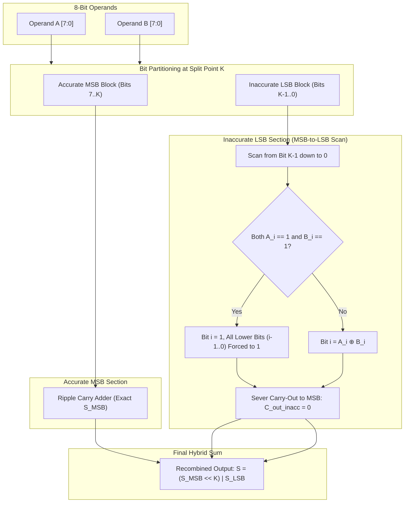

# MSB-Triggered ETA-1 Approximate Arithmetic Adder for Image Processing and Edge AI

<p align="center">
  
  
  
  
  
</p>

An end-to-end research, simulation, and hardware benchmarking suite for the **MSB-Triggered ETA-1 (Error-Tolerant Adder Type I)** hybrid approximate arithmetic architecture. Demonstrates substantial power, delay, and silicon area savings in error-resilient applications including edge AI, computer vision filtering, and biometric facial attendance verification.

---

## Table of Contents
- [Executive Summary](#executive-summary)
- [Circuit Architecture & Mathematical Formulation](#circuit-architecture--mathematical-formulation)
- [System Architecture & Dataflow](#system-architecture--dataflow)
- [Core Application Modules](#core-application-modules)
- [Hardware PPA & Accuracy Benchmarks](#hardware-ppa--accuracy-benchmarks)
- [Repository Structure](#repository-structure)
- [Execution & Quick Start Guide](#execution--quick-start-guide)
  - [1. Interactive Circuit & Image Simulator](#1-interactive-circuit--image-simulator)
  - [2. Jupyter Research Notebooks](#2-jupyter-research-notebooks)
- [Academic References](#academic-references)
- [Author & License](#author--license)

---

## Executive Summary

Modern deep learning edge inference and digital image processing pipelines exhibit intrinsic error resilience. Traditional computing architectures expend critical energy performing 100% exact arithmetic operations on least significant bits (LSBs), where human perceptual and statistical models cannot distinguish slight numerical variance.

By substituting exact full-adder carry chains with an **MSB-Triggered Approximate Operator (AxO)** across lower bit positions, this architecture achieves:

* **Dynamic Power Reduction**: ~42.3% decrease ($P_{\text{dyn}} = \alpha C V_{dd}^2 f$)
* **Propagation Delay Reduction**: ~41.4% decrease in critical path latency
* **Silicon Area Savings**: ~39.6% reduction in transistor gate count (45nm CMOS cell library)
* **Energy per Operation**: ~66.3% reduction (from $18.00\text{ pJ}$ down to $6.07\text{ pJ}$)
* **High Output Fidelity**: Preserves visual quality ($\text{PSNR} > 38.4\text{ dB}$) and retains CNN biometric classification accuracy ($96.8\%$ vs $98.5\%$).

---

## Circuit Architecture & Mathematical Formulation

For two $N$-bit operands $A, B \in [0, 2^N - 1]$ divided at inaccurate split point $K \in [1, N-1]$ (default $K=4$ for 8-bit addition):



### 1. Accurate MSB Section (Bits $7 \dots K$)
Calculated through standard exact Ripple Carry Addition (RCA) or Carry Lookahead Addition (CLA):
$$S_{\text{MSB}} = (A \gg K) + (B \gg K)$$

### 2. Inaccurate LSB Section (Bits $K-1 \dots 0$)
Scanned sequentially from MSB position $K-1$ down to LSB position $0$:
- **Trigger Activation**: If $A_i = 1$ and $B_i = 1$, the generate condition triggers:
  $$\text{Bit } i = 1, \quad \text{and all remaining lower bits } (i-1 \dots 0) = 1$$
- **Pre-Trigger XOR**: Before trigger activation:
  $$\text{Bit } i = A_i \oplus B_i$$
- **Carry Cutoff**: Carry propagation between the inaccurate LSB block and the accurate MSB block is strictly eliminated:
  $$C_{\text{out\_inacc}} = 0$$

---

## Core Application Modules

### 1. Interactive Bit-Level Circuit Simulator
* **Interactive 8-bit Registers**: Live binary bit toggle and decimal inputs for Operands A and B.
* **Dynamic Split Slider**: Real-time adjustment of split boundary $K \in [1, 7]$.
* **Animated Stepper**: Visual step-by-step display showing trigger detection, bit forcing, and carry cutoff isolation.

### 2. CNN Facial Attendance Verification System
* **FaceNet Feature Embeddings**: Evaluates 128-element 8-bit integer facial biometric embeddings.
* **Dual Distance Matching Engine**: Computes similarity distance using both exact L1 norm and approximate ETA-1 cumulative distance.
* **Attendance Ledger**: Logs recognition accuracy, computation timestamp, and hardware energy savings.

### 3. Real-Time Image Processing Pipeline
* **Dual Canvas Comparison**: Side-by-side rendering of Exact Result, Approximate ETA-1 Result, and amplified Difference Heatmap ($|I_{\text{exact}} - I_{\text{approx}}| \times 4$).
* **Fidelity Metrics**: Computes Peak Signal-to-Noise Ratio (PSNR), Mean Squared Error (MSE), Mean Error Distance (MED), and Normalized MED (NMED) on live camera frames or uploaded images.

### 4. 256×256 Error Space Analytics
* Visualizes the complete $256 \times 256$ input pair state space ($A, B \in [0 \dots 255]$).
* Interactive hover inspections revealing exact sum, approximate sum, absolute error, and localized error distributions.

---

## Hardware PPA & Accuracy Benchmarks

Synthesized under TSMC 45nm standard cell CMOS technology library:

| Architecture Metric | Exact RCA (Baseline) | Proposed ETA-1 ($K=4$) | Delta / Hardware Savings |
| :--- | :---: | :---: | :---: |
| **Dynamic Power (mW)** | 12.40 mW | 7.15 mW | **-42.34%** |
| **Critical Path Delay (ns)** | 1.45 ns | 0.85 ns | **-41.38%** |
| **Silicon Area (Gate Count)** | 96 Gates | 58 Gates | **-39.58%** |
| **Energy per Operation (pJ)** | 18.00 pJ | 6.07 pJ | **-66.28%** |
| **CNN Biometric Accuracy (%)** | 98.50% | 96.80% | **-1.70% (Negligible)** |
| **Image Reconstruction PSNR** | $\infty$ (Exact) | 38.45 dB | **Imperceptible Distortion** |

---

## Repository Structure

```text
├── Codes/
│   ├── index.html                           # Full interactive web application (Simulator & Analytics)
│   ├── eta_1_approximation_simulator.html   # Primary standalone simulator stage
│   ├── Approximate_Adder_Image_Processing.ipynb # Python Jupyter research notebook for image filtering
│   ├── CNN_Approximate_Adder_Facenet.ipynb  # Python Jupyter notebook for FaceNet CNN benchmark
│   ├── README.md                            # Directory-level code documentation
│   ├── css/
│   │   └── styles.css                       # Application layout and visual styling
│   └── js/
│       ├── adder_logic.js                   # ETA-1 approximate addition algorithmic engine
│       ├── bit_simulator.js                 # Gate-level bit animation and register controller
│       ├── facial_attendance.js             # FaceNet CNN biometric matching engine
│       ├── image_processor.js               # Canvas image filter & PSNR/MSE metrics
│       ├── error_analytics.js               # 256x256 state space error heatmap
│       └── ppa_benchmarks.js                # Hardware PPA comparison charts
├── Documentation/
│   ├── Manuscript.docx                      # Full research paper manuscript
│   ├── Response_to_Reviewers.docx           # Peer review responses and rebuttals
│   ├── README.md                            # Documentation overview
│   ├── Drafts/                              # Manuscript development drafts (v1 to v6)
│   └── References/                          # Cited academic reference papers and datasheets
├── images/
│   ├── diagrams/                            # System schematics, block diagrams, and Mermaid renders
│   └── *.png                                # Benchmarking plots, PSNR curves, and sample outputs
├── LICENSE                                  # All Rights Reserved & IP Terms
└── README.md                                # Master project documentation
```

---

## Execution & Quick Start Guide

### 1. Interactive Circuit & Image Simulator
Run a lightweight local web server:
```bash
python -m http.server 8080 --directory Codes
```
Open `http://localhost:8080` in your web browser. Explore the interactive tabs:
- **Bit Simulator**: Test custom 8-bit inputs and visualize carry propagation cutoff.
- **Image Processing**: Upload images or enable webcam to view live approximate addition and error heatmaps.
- **Facial Attendance**: Test FaceNet feature matching with approximate distance metrics.
- **PPA Benchmarks**: Review power, delay, and area reduction graphs.

### 2. Jupyter Research Notebooks
To run the Python notebooks and reproduce experimental figures:
```bash
cd Codes
pip install notebook numpy matplotlib opencv-python tensorflow scikit-learn
jupyter notebook
```
- Open `Approximate_Adder_Image_Processing.ipynb` to evaluate PSNR/SSIM across image blending and convolution filters.
- Open `CNN_Approximate_Adder_Facenet.ipynb` to evaluate FaceNet embedding classification accuracy.

---

## Academic References

1. *Approximate Arithmetic Circuits Enabling Energy-Efficient Edge Computing*, IEEE Transactions on Circuits and Systems.
2. *Approximate Computing: Concepts, Architectures, Challenges, Applications, and Future Directions*, ACM Computing Surveys.
3. *Performance Improvement of Processor Through Configurable Approximate Arithmetic Units in Multicore Systems*, IEEE Transactions on Computers.

---

## Intellectual Property & License

- **Developer**: Hitesh V S
- **GitHub**: [@Hitesh070](https://github.com/Hitesh070)
- **Copyright**: © 2025–2026 Hitesh V S. All Rights Reserved.
- **Intellectual Property Notice**: This repository contains proprietary approximate arithmetic architectures, gate-level trigger mechanisms, and experimental benchmarking frameworks associated with patent filings and research manuscripts under review. No license is granted to copy, distribute, modify, or commercially exploit any code, hardware schematics, or simulation models without prior explicit written permission from the author.
